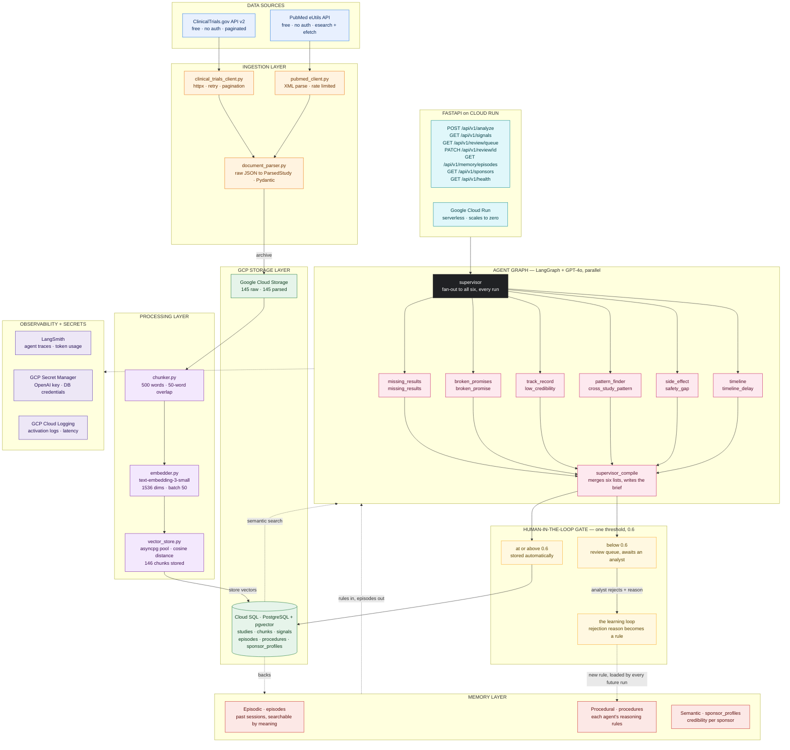

# MOSAIC

**Multi-Agent Operating System for AI Cognition** — a clinical trial research
integrity system. Six specialist AI agents run in parallel over
ClinicalTrials.gov and PubMed data, looking for evidence that sponsors have
broken their obligations: results never posted, outcomes switched mid-study,
safety events published but never filed, deadlines missed in silence.

Every finding carries a confidence score. Confident findings are published;
uncertain ones go to a human analyst. When an analyst rejects one, their
explanation becomes a permanent reasoning rule for the agent that got it
wrong — so a correction given once changes every future run.

---

## Architecture



Solid arrows carry data; dashed arrows carry rules, traces and retrieval.
Counts are the live figures from the current database, not capacities.

---

## Quick start

```bash
# 1. dependencies
pip install -r requirements.txt

# 2. configuration
cp .env.example .env     # then fill in OPENAI_API_KEY and the DB_* values

# 3. database schema (idempotent — safe to re-run)
psql "host=$DB_HOST port=5432 dbname=$DB_NAME user=$DB_USER" \
     -f deployment/gcp/cloudsql_init.sql

# 4. run it
uvicorn api.main:app --reload
```

Then open **http://localhost:8000/docs** for the interactive API, or:

```bash
curl http://localhost:8000/api/v1/health

curl -X POST http://localhost:8000/api/v1/analyze \
  -H 'Content-Type: application/json' \
  -d '{"nct_ids": ["NCT00011531"], "max_studies": 3,
       "task": "Find completed trials whose sponsor never posted results"}'
```

A six-agent run takes roughly 20-30 seconds and makes real OpenAI calls.

---

## How it works

```
                  POST /api/v1/analyze
                           │
                    ┌──────▼───────┐
                    │  supervisor  │  stamps the run, clears state
                    └──────┬───────┘
      ┌───────────┬────────┼────────┬───────────┬───────────┐
      ▼           ▼        ▼        ▼           ▼           ▼
 missing_     broken_    track_   pattern_   side_      timeline
 results     promises    record    finder    effect
      │           │        │        │           │           │
      └───────────┴────────┼────────┴───────────┴───────────┘
                           ▼
                  ┌──────────────────┐
                  │ supervisor_compile│  writes the brief
                  └─────────┬────────┘
                            ▼
                     ┌────────────┐
                     │ HITL gate  │  >= 0.6 publish · < 0.6 human review
                     └─────┬──────┘
                           │ rejection + reason
                           ▼
                   procedural memory  ──→ every future run of that agent
```

All six specialists run on every task. They look for different things in the
same data, and six in parallel costs about what one costs in wall-clock time,
so selective routing would only create a way to miss a signal type.

### The six agents

| Agent | Looks for | Signal type |
|---|---|---|
| `missing_results_agent` | Completed trials that never posted results (FDAAA 801) | `missing_results` |
| `broken_promises_agent` | Primary outcomes switched after enrollment began | `broken_promise` |
| `track_record_agent` | Sponsors with a pattern of non-compliance | `low_credibility` |
| `pattern_finder_agent` | Patterns across three or more studies | `cross_study_pattern` |
| `side_effect_agent` | Safety events in published papers but not in the filing | `safety_gap` |
| `timeline_agent` | Silent delays — past deadline with no amendment filed | `timeline_delay` |

### Three kinds of memory

| Store | Table | Holds |
|---|---|---|
| Episodic | `episodes` | Past reasoning sessions, searchable by meaning |
| Procedural | `procedures` | Each agent's reasoning rules — defaults plus what humans taught it |
| Semantic | `sponsor_profiles` | A living credibility profile per sponsor |

---

## Layout

```
config/       settings (one typed source of truth) and logging
ingestion/    ClinicalTrials.gov + PubMed clients, parsing, GCS archive
processing/   chunking, embedding, pgvector storage and search
memory/       the three memory stores
tools/        the 14 tools agents call, plus the sync/async bridge
agents/       six specialists, the supervisor, shared parser and executor
graph/        the LangGraph wiring and the human-in-the-loop gate
api/          FastAPI app, four routers, shared read pool
evaluation/   precision/recall scoring and a runnable evaluation harness
deployment/   Dockerfile, Cloud Run service, database schema
tests/        339 tests, all offline
```

---

## API

| Method | Path | Purpose |
|---|---|---|
| `POST` | `/api/v1/analyze` | Run all six agents, return the brief |
| `GET` | `/api/v1/signals` | List signals (filter by agent, type, status) |
| `GET` | `/api/v1/signals/{id}` | One signal with its evidence |
| `GET` | `/api/v1/review/queue` | Signals awaiting a human, least confident first |
| `PATCH` | `/api/v1/review/{id}` | Approve, edit or reject — a reject teaches the agent |
| `GET` | `/api/v1/memory/episodes` | Search past agent sessions by meaning |
| `GET` | `/api/v1/memory/procedures/{agent}` | An agent's current rules, default vs learned |
| `GET` | `/api/v1/sponsors` | Sponsor profiles, worst credibility first |
| `GET` | `/api/v1/sponsors/{name}` | One sponsor's profile |
| `GET` | `/api/v1/health` | Status, database connectivity, queue depth |

---

## Pipelines

```bash
python -m ingestion.run_ingestion    # fetch trials + papers → GCS
python -m processing.run_processing   # chunk + embed → Cloud SQL
```

Both are re-runnable. Ingestion skips studies already archived; processing
skips studies that already have chunks.

---

## Evaluation

```bash
python -m evaluation.eval_runner --dry-run              # free: show the labels
python -m evaluation.eval_runner --violations 3 --compliant 3
```

Ground truth is derived from the registry by the FDAAA rule itself: a
COMPLETED trial with no results posted more than 12 months after primary
completion is a violation; a COMPLETED trial with results is not. Both
classes are sampled, because **compliant trials are the only way a false
positive can be counted** — and a false accusation against a sponsor who
complied is the expensive mistake.

Last recorded run (n=6):

```
precision 1.00   recall 1.00   f1 1.00
tp/fp/fn/tn  3/0/0/3        6/6 agents activated, 28.4s
```

That sample is small, and the labels come from the same registry fields the
agents can read — so it measures whether the agents apply the rule correctly,
not whether the registry is accurate.

---

## Tests

```bash
pytest                  # 339 tests, no network, no database, no OpenAI
pytest --cov            # coverage report
```

Everything is offline: the LLM, the stores and the HTTP clients are replaced
with fakes. A test that called gpt-4o would cost money, need the network and
return something different each run — and would be testing the model, not the
code.

Coverage is **82%** overall. What remains uncovered is almost entirely code
whose only job is I/O against live services: the two `run_*.py` pipeline
scripts, `gcs_store.py`, and the HTTP plumbing inside the two API clients.
The decision-making code is covered far more tightly:

| Area | Coverage |
|---|---|
| The six agent nodes, supervisor, graph, state | 100% |
| `api/schemas.py`, `analysis` router, `scorers.py` | 100% |
| `search_tools.py`, `api/db.py`, `signals` router | 95-98% |
| `hitl.py` (the publish/review decision), `chunker`, `embedder` | 90-92% |
| The three memory stores | 83-88% |

---

## Deployment

```bash
docker build -f deployment/Dockerfile -t mosaic-api .
docker run --rm -p 8000:8000 --env-file .env mosaic-api
```

For Cloud Run, see the header comments in `deployment/Dockerfile` and
`deployment/gcp/cloud_run.yaml`. In production `DB_HOST` becomes the injected
socket path (`/cloudsql/PROJECT:REGION:INSTANCE`), and `OPENAI_API_KEY` and
`DB_PASSWORD` come from Secret Manager rather than `.env`.

---

## Known limitations

- **Papers are archived but not embedded.** `run_ingestion.py` fetches PubMed
  papers and stores them in GCS, but `run_processing.py` only chunks studies,
  so `chunks` holds no `source='paper'` rows. The `search_papers_by_meaning`
  tool therefore has nothing to search, and no agent currently uses it. The
  side effect agent is unaffected — it queries PubMed live.
- **No vector index.** Exact pgvector scans are used deliberately. An ivfflat
  index at the current table sizes made recall *worse*, silently; see the long
  note in `deployment/gcp/cloudsql_init.sql` before adding one back.
- **`min_similarity` is calibrated to one embedding model.** The 0.3 default
  on episodic search was measured against `text-embedding-3-small`. Change the
  model and the threshold has to be re-measured.
- **Two HTTP libraries.** `clinical_trials_client.py` uses `requests`,
  `pubmed_client.py` uses `httpx`. Both are required until one is ported.
- **Evaluation sample is small.** See the caveats under Evaluation above.
